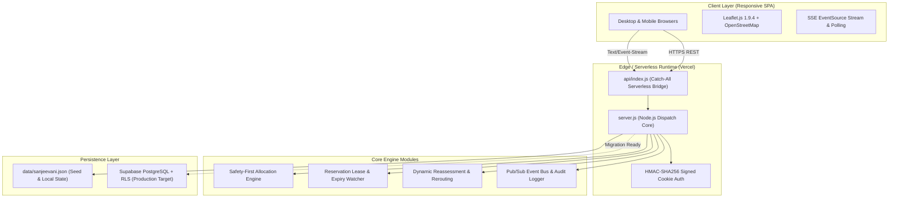
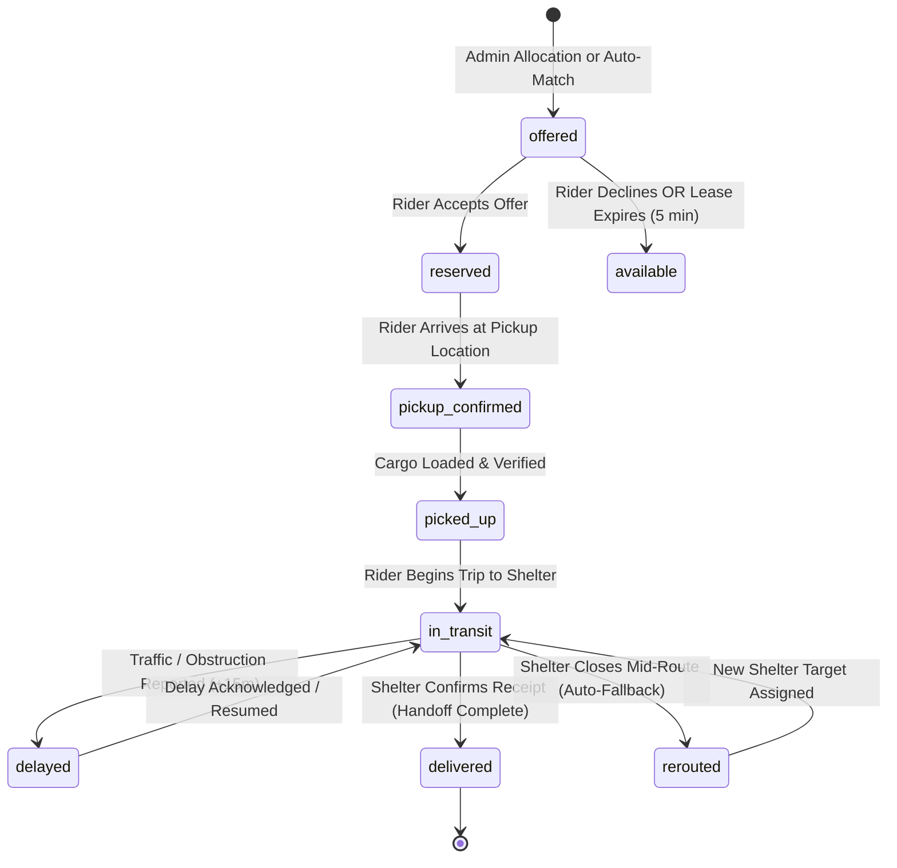

# 🌿 Sanjeevani — Master Project Documentation

> **Delivering What Matters When It Matters.**
> A Real-Time, Constraints-Driven Civic Micro-Logistics Platform for Perishable Food Surplus, Emergency Medical Supplies, and Disaster Relief Coordination.

---

## 📌 Table of Contents
1. [Project Overview & Key Objectives](#1-project-overview--key-objectives)
2. [Live Links & Repository Locations](#2-live-links--repository-locations)
3. [System Architecture & Invariants](#3-system-architecture--invariants)
4. [Data Models & Entities](#4-data-models--entities)
5. [Safety-First Allocation Engine](#5-safety-first-allocation-engine)
6. [Finite State Machine & Custody Lifecycle](#6-finite-state-machine--custody-lifecycle)
7. [Security & Session Architecture](#7-security--session-architecture)
8. [Complete REST API Reference](#8-complete-rest-api-reference)
9. [User Guide by Persona](#9-user-guide-by-persona)
10. [Rider GPS & Turn-by-Turn Navigation Map](#10-rider-gps--turn-by-turn-navigation-map)
11. [Scenario Lab & Chaos Engineering](#11-scenario-lab--chaos-engineering)
12. [Deployment & DevOps Manual](#12-deployment--devops-manual)
13. [Local Development & Verification Testing](#13-local-development--verification-testing)

---

## 1. Project Overview & Key Objectives

During civic emergencies, daily hotel/canteen operations, and disaster relief events, massive quantities of freshly prepared hot food, emergency rations, and temperature-sensitive medicines are lost simply because coordination fails before shelf-life expires. 

Traditional logistics apps treat deliveries as unconstrained point-to-point courier jobs. **Sanjeevani** treats them as **safety-critical mathematical constraints**:
- Perishable hot meals have strict 45–120 minute safe-use windows.
- Cold-chain medical kits require specific storage handling.
- Volunteer riders have vehicle payload limits and fluctuating availability.
- Night shelters and relief camps have strict intake capacities, dynamic needs, and utility requirements (clean water and cooking fuel).

Sanjeevani bridges this gap through a high-frequency, responsive web platform featuring:
- **Safety-First Allocation Engine**: Automatically computes route viability against shelf-life countdowns.
- **Turn-by-Turn Rider Navigation**: Dedicated HUD with live route polylines, radar beacon, and step-by-step handoff actions.
- **1-Click Workspace Role Switcher**: Instant evaluation of all four operational personas without logging out.
- **Real-Time Cross-Device Synchronization**: Instant updates via Server-Sent Events (SSE).

---

## 2. Live Links & Repository Locations

- **Production Web Application**: [https://sanjeevani-henna-alpha.vercel.app](https://sanjeevani-henna-alpha.vercel.app)
- **GitHub Repository**: [https://github.com/shauryawankhade1923-creator/sanjeevani](https://github.com/shauryawankhade1923-creator/sanjeevani)
- **Local Workspace**: `C:\Users\SHAURYA\Downloads\Sanjeevani-main\Sanjeevani-main`
- **Simulated Region**: Pune & Alandi, Maharashtra, India (`18.588° N, 73.899° E`)

---

## 3. System Architecture & Invariants



### Key Architectural Invariants:
1. **Never allocate unsafe surplus**: If total estimated arrival time plus a 15-minute safety buffer exceeds the food's safe-use deadline, the system hard-rejects the match.
2. **Exactly-once reservation release**: Reservation offers expire after 5 minutes if unacknowledged by the rider; reserved quantities automatically return to the open surplus pool.
3. **Stateless serverless continuity**: Authentication relies on HMAC-SHA256 signed cookies rather than in-memory server maps, ensuring zero session loss during serverless cold starts.

---

## 4. Data Models & Entities

```
┌────────────────┐       1..* ┌────────────────┐
│   Donation     │ ────────── │    Shipment    │
└────────────────┘            └────────────────┘
                                  │          │
                     assigned to  │          │ delivered to
                                  ▼          ▼
                        ┌─────────────┐  ┌─────────────┐
                        │    Rider    │  │   Center    │
                        └─────────────┘  └─────────────┘
                                                │ 1..* has
                                                ▼
                                         ┌─────────────┐
                                         │   Demand    │
                                         └─────────────┘
```

### Entity Schemas:
- **Donation**: `id`, `donorId`, `donorName`, `title`, `category`, `originalQuantity`, `availableQuantity`, `reservedQuantity`, `pickedUpQuantity`, `deliveredQuantity`, `safeUntil`, `storage`, `handling`, `pickupLocation` (`name`, `address`, `lat`, `lng`), `status`.
- **Center**: `id`, `name`, `type`, `address`, `lat`, `lng`, `isOpen`, `capacity`, `occupancy`, `water`, `fuel`, `receivingHours`.
- **Demand**: `id`, `centerId`, `category`, `unit`, `quantity`, `priority`, `acceptedCategories`.
- **Rider**: `id`, `name`, `phone`, `vehicle`, `capacity`, `capacityReserved`, `availability`, `lat`, `lng`, `lastSeenAt`, `reliability`, `userId`.
- **Shipment**: `id`, `donationId`, `riderId`, `centerId`, `quantity`, `unit`, `status`, `offeredAt`, `acceptedAt`, `pickedUpAt`, `inTransitAt`, `deliveredAt`, `etaAt`, `reservationExpiresAt`, `delayMinutes`, `safeUntil`.

---

## 5. Safety-First Allocation Engine

The allocation engine (`autoDispatch` / `POST /api/admin/allocate-best`) validates 7 sequential safety constraints before proposing a shipment:

$$\text{ETA} = T_{\text{current}} + \text{Transit}(\text{Rider} \to \text{Pickup}) + \text{LoadTime} + \text{Transit}(\text{Pickup} \to \text{Center}) + \text{Buffer}$$

1. **Center Status Check**: Center must be explicitly `isOpen === true`.
2. **Category Compatibility**: Center `acceptedCategories` must include the donation category.
3. **Capacity Threshold**: Center `occupancy + quantity <= capacity`.
4. **Demand Matching**: Center has positive unfulfilled demand (`demand.quantity >= quantity`).
5. **Rider Capacity**: Available rider payload `(capacity - capacityReserved) >= quantity`.
6. **Utility Readiness**: Perishable cooking/refrigeration items require operational water/fuel.
7. **Strict Expiry Invariant**:
   $$\text{ETA} + 15\text{ minutes} < \text{Donation.safeUntil}$$

---

## 6. Finite State Machine & Custody Lifecycle



---

## 7. Security & Session Architecture

- **Session Signing**: Sessions are encoded as base64 JSON and signed with an HMAC-SHA256 signature using `SESSION_SECRET`.
- **Cookie Security**: `Set-Cookie: sanjeevani_session=...; Path=/; HttpOnly; SameSite=Lax`.
- **Role-Based Access Control (RBAC)**:
  - `admin`: Global access, manual allocation, scenario lab triggers, database reset.
  - `donor`: Donation creation, donor-specific metrics.
  - `rider`: Responding to offers, updating GPS coordinates (`POST /api/riders/me`), transit state transitions.
  - `shelter`: Demand updates, center capacity/status toggling, delivery handoff confirmations.

---

## 8. Complete REST API Reference

| Method | Endpoint | Access | Description |
| :--- | :--- | :--- | :--- |
| `POST` | `/api/auth/login` | Public | Authenticates user; returns user object and signed cookie. |
| `POST` | `/api/auth/switch` | Authenticated | 1-click workspace switcher to another role (`admin`, `donor`, `rider`, `shelter`). |
| `POST` | `/api/auth/logout` | Authenticated | Clears session cookie. |
| `GET` | `/api/auth/me` | Authenticated | Returns current authenticated user profile. |
| `GET` | `/api/state` | Authenticated | Scoped snapshot of network shipments, centers, riders, and metrics. |
| `GET` | `/api/events/stream` | Public/Auth | Server-Sent Events (SSE) push stream for real-time updates. |
| `POST` | `/api/donations` | `donor`, `admin` | Creates a new surplus donation batch with safe-use expiry. |
| `POST` | `/api/admin/allocate-best` | `admin` | Runs safety allocation engine for a specified donation ID. |
| `POST` | `/api/shipments/:id/:action` | Role-protected | Advances shipment status (`accept`, `reject`, `pickup-arrived`, `picked-up`, `in-transit`, `report-delay`, `delivered`). |
| `POST` | `/api/riders/me` | `rider` | Updates rider GPS (`lat`, `lng`) and availability (`available`, `on_delivery`, `offline`). |
| `POST` | `/api/centers/:id/status` | `shelter`, `admin`| Toggles center open/closed state; auto-reroutes affected deliveries. |
| `POST` | `/api/centers/:id/demand` | `shelter`, `admin`| Updates center demand quantity for a specific category. |
| `POST` | `/api/admin/scenario` | `admin` | Triggers Scenario Lab tests (`urgent`, `split`, `no-show`, `advance-time`, `closure`, `delay`, `movement`, `reset`). |

---

## 9. User Guide by Persona

### Quick Credentials:
All demo profiles share the password: **`SanjeevaniDemo!2026`**

| Role | Email | Best For |
| :--- | :--- | :--- |
| **Administrator** | `admin@demo.sanjeevani.app` | Dispatch operations, auto-matching, chaos testing |
| **Surplus Donor** | `donor@demo.sanjeevani.app` | Posting surplus food and medical batches |
| **Volunteer Rider** | `rider@demo.sanjeevani.app` | Turn-by-turn navigation, GPS stepping, package delivery |
| **Receiving Center** | `shelter@demo.sanjeevani.app` | Requesting aid, updating demand, confirming receipts |

*(Use the topbar profile chip to switch roles instantly with a single click!)*

---

## 10. Rider GPS & Turn-by-Turn Navigation Map

When logged in as a **Volunteer Rider**, clicking **"My map"** opens the dedicated navigation terminal:

1. **Turn-by-Turn HUD**:
   - Live status badge (*Heading to Pickup*, *Cargo Loaded*, *In Transit*, *Delayed*).
   - Safe-use countdown clock showing time remaining before cargo expires.
   - Sequential step cards for Pickup Location ➔ Dropoff Shelter ➔ Payload Details.
2. **Interactive Leaflet Map**:
   - **🛵 You (Rider GPS)**: Glowing radar beacon pin with live coordinates.
   - **📦 Pickup Pin**: Donor location with quantity and safe shelf-life details.
   - **🏥 Destination Pin**: Receiving center with address and operating hours.
   - **Route Polylines**: Vibrant animated dashed emerald polyline for active legs and muted lines for upcoming hops.
3. **GPS Controls**:
   - **⚡ Step GPS Along Route**: Advances the rider 35% closer towards the active waypoint and updates the server via `POST /api/riders/me`. Alerts rider upon arrival within 200m.
   - **🎯 Center On Me**: Instantly flies the camera to the rider's position.
   - **Patrol Mode**: Advances patrol GPS beacon when idle.

---

## 11. Scenario Lab & Chaos Engineering

Accessible under **Administrator > Scenario Lab**:
- **Create Urgent Donation**: Injects a 180-meal batch with an aggressive 35-minute deadline.
- **Split Batch**: Divides large batches across multiple riders and shelters.
- **Simulate Rider No-Show**: Forces a reservation lease to expire and verifies automatic return to open surplus.
- **Advance Simulation Clock**: Advances time by 10 minutes to test countdown timers.
- **Close Shelter Mid-Route**: Simulates emergency shelter closure and triggers automatic rerouting to candidate centers.
- **Simulate Route Delay**: Injects a 25-minute delay and tests attention board escalation.
- **Reset Demo Data**: Reverts state back to clean initial demo baseline.

---

## 12. Deployment & DevOps Manual

### Production on Vercel:
- **Serverless Entrypoint**: `api/index.js` wraps `server.js` as an asynchronous catch-all serverless function.
- **Static Asset Serving**: Handled at edge via `public/`.
- **Deploy Command**: `vercel --prod --yes`

### Environment Variables:
| Key | Purpose | Required |
| :--- | :--- | :--- |
| `NODE_ENV` | Environment flag (`production` or `development`) | No |
| `SESSION_SECRET` | Secret key used to sign HMAC-SHA256 session cookies | **Yes** |
| `DEMO_PASSWORD` | Shared password for the 4 demo accounts | No (has fallback) |
| `SUPABASE_URL` | Supabase instance URL (for persistent DB cutover) | Optional |
| `SUPABASE_SERVICE_ROLE_KEY` | Supabase administrative key | Optional |

---

## 13. Local Development & Verification Testing

```bash
# 1. Clone repository
git clone https://github.com/shauryawankhade1923-creator/sanjeevani.git
cd sanjeevani

# 2. Syntax check
npm run check

# 3. Start development server
npm run dev
```

### Running Automated Smoke Tests:
```bash
# Test against production
$env:BASE_URL = "https://sanjeevani-henna-alpha.vercel.app"
node scripts/smoke-test.js
```
Expected output:
```text
Sanjeevani smoke test passed: auth, shared donation, role protection, and scenario mutation.
```
