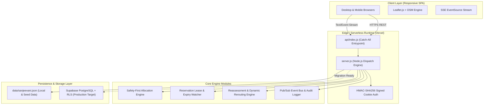
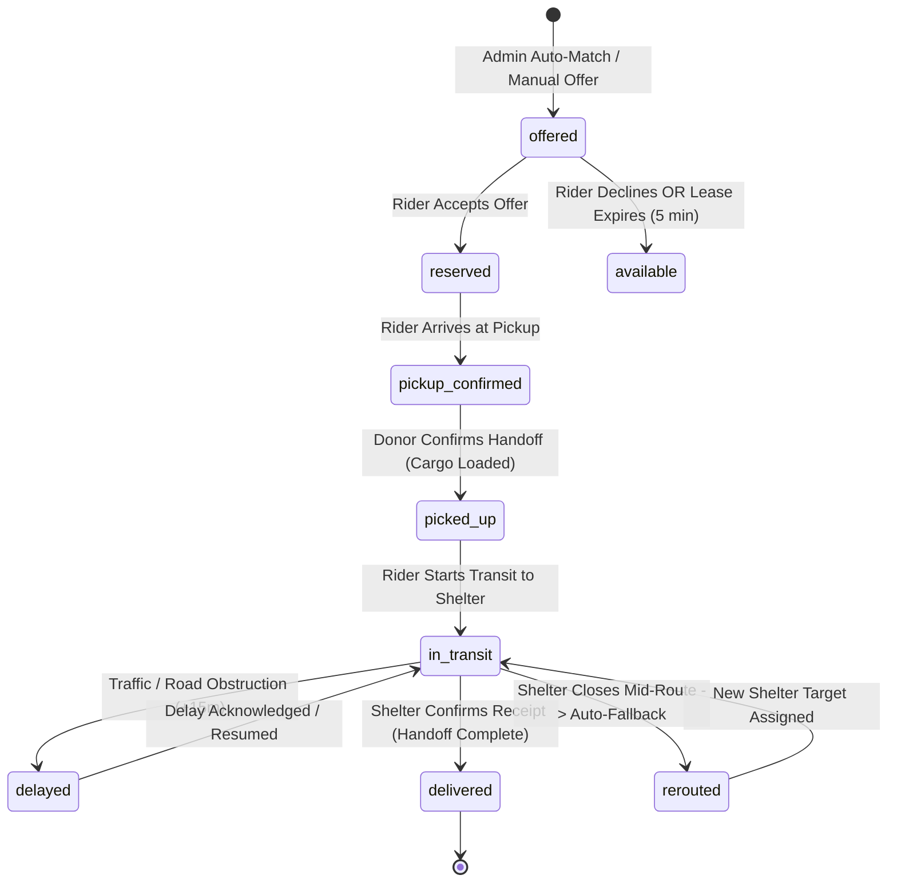

# Sanjeevani — System Architecture & Design Specification

> **Civic Micro-Logistics Platform for Perishable Surplus & Disaster Relief Coordination**

---

## 1. High-Level Architectural Overview

Sanjeevani is engineered as a real-time, constraints-driven civic micro-logistics platform designed to connect **food/medical donors**, **volunteer dispatchers & riders**, and **receiving emergency shelters/camps** in real time before critical perishables expire.

---

## 2. Core Entities & Data Model

The data layer models five primary domain entities:

1. **Donation (`donations`)**:
   - Represents a surplus food batch, medical kit, or emergency ration line.
   - Properties: `category`, `originalQuantity`, `availableQuantity`, `reservedQuantity`, `pickedUpQuantity`, `deliveredQuantity`, `safeUntil` (hard shelf-life expiry timestamp), `storage` (`Room temperature`, `Refrigerated`, `Dry storage`), `handling`, `pickupLocation` (`name`, `lat`, `lng`, `address`).
2. **Receiving Center (`centers`)**:
   - Night shelters, community kitchens, and disaster relief camps.
   - Properties: `name`, `type`, `lat`, `lng`, `address`, `isOpen`, `capacity`, `occupancy`, utilities (`water`, `fuel`), `receivingHours`.
3. **Demand Line (`demands`)**:
   - Explicit need per center and category.
   - Properties: `centerId`, `category`, `unit`, `quantity`, `priority` (`urgent`, `normal`), `acceptedCategories`.
4. **Volunteer Rider (`riders`)**:
   - Dynamic mobile fleet agents.
   - Properties: `name`, `phone`, `vehicle` (`Scooter`, `Cargo bike`, `Electric van`), `capacity`, `capacityReserved`, `availability` (`available`, `on_delivery`, `offline`), `lat`, `lng`, `lastSeenAt`, `reliability`.
5. **Shipment (`shipments`)**:
   - The verified stateful chain-of-custody ledger record.
   - Properties: `donationId`, `riderId`, `centerId`, `quantity`, `unit`, `status`, `offeredAt`, `acceptedAt`, `pickedUpAt`, `inTransitAt`, `deliveredAt`, `etaAt`, `reservationExpiresAt`, `delayMinutes`, `safeUntil`.

---

## 3. Allocation Engine & Safety Invariants

The allocation algorithm (`autoDispatch` and `/api/admin/allocate-best`) executes strict safety checks before any offer or dispatch is generated:

### Safety Feasibility Formula:
$$\text{ETA} = T_{\text{now}} + T_{\text{pickup}}(\text{Rider} \to \text{Donor}) + T_{\text{load}} + T_{\text{transit}}(\text{Donor} \to \text{Center}) + \text{Margin}$$

An allocation is marked **valid** if and only if:
1. **Category Acceptance**: The receiving center accepts the donation's category.
2. **Receiving Center Status**: The center is explicitly `isOpen === true`.
3. **Shelter Capacity**: Center current `occupancy + quantity <= capacity`.
4. **Demand Matching**: Center has positive unfulfilled demand for the given category (`demands.quantity >= quantity`).
5. **Rider Capacity**: Rider available payload `(capacity - capacityReserved) >= quantity`.
6. **Utility Dependencies**: If perishable hot food or cold-chain medicine requires water/fuel/electricity, the center's utility flags must pass.
7. **Strict Expiry Invariant**:
   $$\text{ETA} + \text{Buffer (15 min)} < \text{Donation.safeUntil}$$
   If a shipment cannot reach the shelter with at least 15 minutes of safe shelf-life remaining, it is **strictly rejected**.

---

## 4. Finite State Machine (FSM)

---

## 5. Security & Session Model

- **Stateless HMAC-SHA256 Signed Cookies**:
  - The authentication system issues signed cookies (`sanjeevani_session.signature`).
  - Immune to serverless in-memory restarts and horizontal scaling.
  - Role-based authorization enforced on every sensitive mutation:
    - `admin`: Allocation, scenario lab mutations, system reset.
    - `donor`: Donation creation, donor-specific analytics.
    - `rider`: Accepting/rejecting assignments, GPS telemetry updates (`POST /api/riders/me`), transit state transitions.
    - `shelter`: Demand modification, opening/closing center status, delivery confirmation.

---

## 6. Real-Time Synchronization

- **Server-Sent Events (SSE)**: Endpoint `/api/events/stream` streams events to active clients.
- **Adaptive Visibility Polling Fallback**: When running on serverless environments where connection duration is bounded, the client polls `/api/state` every 4 seconds when the browser tab is focused, guaranteeing real-time updates across multiple devices.
