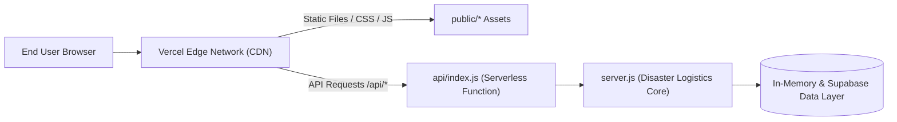

# Sanjeevani — Deployment & Operations Guide

> **Deploying Sanjeevani on Vercel and Supabase**

---

## 1. Production Architecture (Vercel)

The live production deployment runs on **Vercel Serverless Architecture**:

- **Production URL**: [https://sanjeevani-henna-alpha.vercel.app](https://sanjeevani-henna-alpha.vercel.app)
- **GitHub Repository**: [shauryawankhade1923-creator/sanjeevani](https://github.com/shauryawankhade1923-creator/sanjeevani)
- **Node.js Runtime**: `20.x`+
- **Entrypoint**: `api/index.js` exports an async request handler that dynamically imports and routes all incoming HTTP traffic through `server.js`.
- **Static Assets**: Root `public/` directory (served by Vercel's Edge CDN).



---

## 2. Environment Variables Configuration

Set these in your Vercel Project Settings (`Settings > Environment Variables`) or in your local `.env`:

| Variable | Description | Required | Example |
| --- | --- | --- | --- |
| `NODE_ENV` | Runtime environment | No (defaults to `production`) | `production` |
| `SESSION_SECRET` | HMAC-SHA256 cookie signing secret | **Yes** | `f94a8c1e309...` (64+ char random string) |
| `DEMO_PASSWORD` | Shared password for the 4 demo accounts | No (has fallback) | `SanjeevaniDemo!2026` |
| `SUPABASE_URL` | Supabase Project URL | Optional (for DB cutover) | `https://xyz.supabase.co` |
| `SUPABASE_ANON_KEY` | Public Supabase client key | Optional (for DB cutover) | `eyJhbGciOi...` |
| `SUPABASE_SERVICE_ROLE_KEY` | Supabase backend admin key | Optional (Server-only) | `eyJhbGciOi...` |
| `OSRM_BASE_URL` | OpenStreetMap routing engine URL | Optional | `https://router.project-osrm.org` |

---

## 3. Local Development Setup

### Prerequisites
- Node.js `20.0.0` or higher
- Git

### Steps:
```bash
# 1. Clone repository
git clone https://github.com/shauryawankhade1923-creator/sanjeevani.git
cd sanjeevani

# 2. Install dependencies (pure Node.js built-ins, zero bloat)
npm install

# 3. Initialize environment
cp .env.example .env

# 4. Verify code integrity
npm run check

# 5. Start development server
npm run dev
```

Visit `http://localhost:4173` in your browser.

---

## 4. Deploying to Vercel via CLI

```bash
# Link to your Vercel team/project
vercel link

# Deploy a preview build
vercel

# Promote to production
vercel --prod --yes
```

---

## 5. Automated Verification & Smoke Testing

A production health suite is bundled in `scripts/smoke-test.js`. It tests:
1. Multi-role authentication (Admin, Donor, Rider).
2. Stateless signed cookie validation.
3. Donation creation by a donor.
4. Real-time shared visibility on the admin dispatch board.
5. Role-based authorization walls (verifies that riders cannot reset admin scenarios).
6. Deterministic scenario execution.

Run the test against production:
```bash
$env:BASE_URL = "https://sanjeevani-henna-alpha.vercel.app"
node scripts/smoke-test.js
```
Expected output:
```text
Sanjeevani smoke test passed: auth, shared donation, role protection, and scenario mutation.
```

---

## 6. Supabase Database Migration (Optional Persistence Cutover)

A complete PostgreSQL schema with Row-Level Security (RLS) policies and triggers is located at:
`supabase/migrations/001_initial_schema.sql`

To deploy to Supabase:
1. Open the **SQL Editor** in your Supabase dashboard.
2. Paste the contents of `001_initial_schema.sql` and run.
3. Configure `SUPABASE_URL` and `SUPABASE_SERVICE_ROLE_KEY` in your hosting platform.
